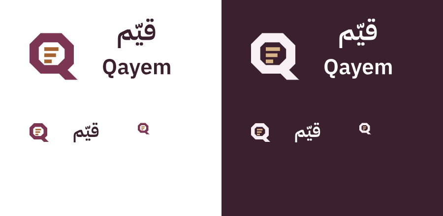
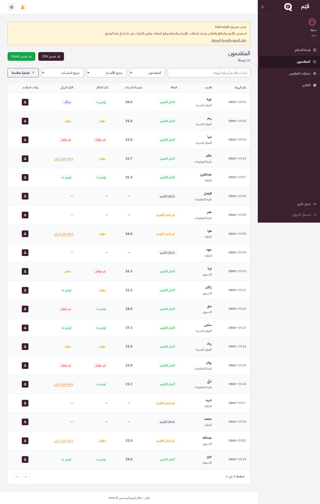
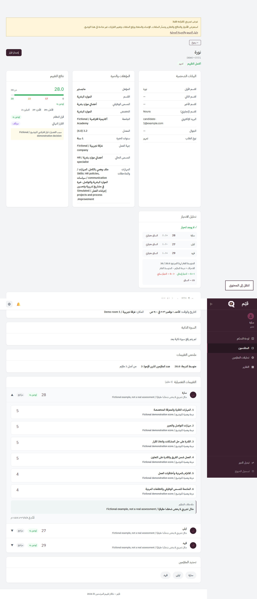
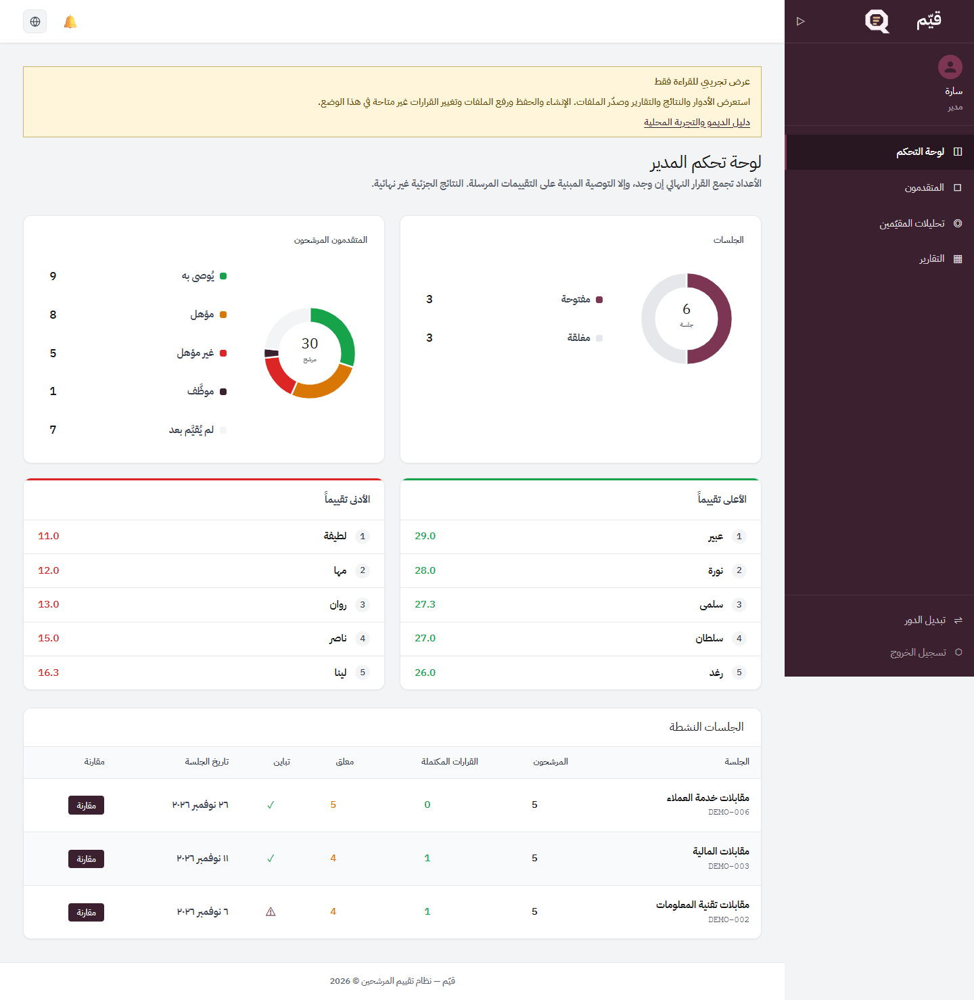
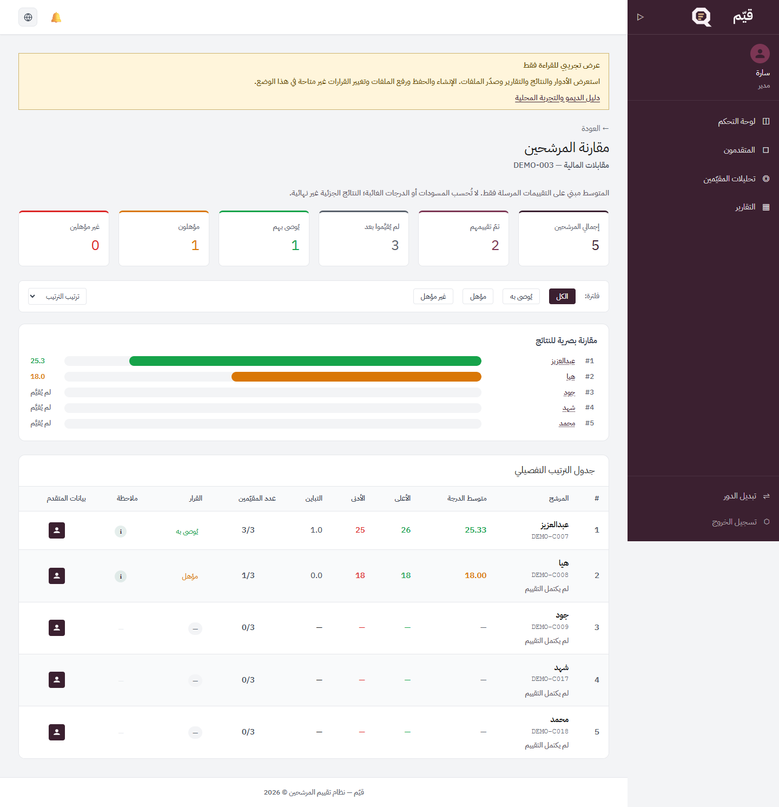

# قيّم | Qayem

منصة مستقلة ثنائية اللغة لإدارة المقابلات وتقييم المرشحين، بأربع مساحات عمل: الإدارة، إدخال البيانات، المقيّم، والمدير. Java 21 / Spring Boot وReact / TypeScript. هوية عنابية وحبرية مع تفاصيل برونزية، وشعار Q يعبر عن التقييم المنظم مع كتابة عربية مضبوطة ومتوازنة. راجع [الشعار وإصداراته](docs/BRAND.md).

## التشغيل على Windows

المتطلبات: Java 21 وMaven 3.9+ على PATH، وNode.js 24 مع npm. افتح PowerShell داخل مجلد Qayem:

```powershell
.\scripts\start-demo.ps1
```

في وضع العرض لا تحتاج إلى كلمة مرور. يُنشئ الخادم كلمة عشوائية داخل الذاكرة ولا يرسلها للواجهة. في نافذة PowerShell ثانية:

```powershell
cd frontend
npm ci
npm run dev
```

افتح http://localhost:5200 واضغط **«دخول تجريبي»** للوصول مباشرة إلى الأدوار الأربعة دون معرفة كلمة مرور. يعمل API على http://localhost:5020. إذا منع Windows تشغيل السكربت، يمكن السماح به للجلسة الحالية فقط باستخدام `Set-ExecutionPolicy -Scope Process Bypass` بعد مراجعته. تحقق من `java -version` و`mvn -version` و`node --version` عند تعذر التشغيل.

لا يتطلب الديمو PostgreSQL أو Docker أو خدمة ذكاء اصطناعي. قاعدة H2 مؤقتة، يعاد إنشاؤها عند إعادة تشغيل الخادم. جميع الأشخاص والسجلات افتراضية، والبريد يستخدم نطاق example.invalid.

## بيانات الديمو والتجربة

6 جلسات و30 مرشحًا بأسماء أولى وهمية طبيعية، موزعين بالتساوي على الموارد البشرية وتقنية المعلومات والمالية والتسويق والعمليات وخدمة العملاء. يوجد 8 مقيّمين و90 إسنادًا؛ و63 تقييمًا مرسلًا و6 مسودات و21 إسنادًا لم يبدأ بعد. تتضمن البيانات 20 مرشحًا مكتمل التقييم، و6 غير مكتملين، و4 بانتظار بدء التقييم، و4 حالات تباين و13 قرارًا نهائيًا. تعكس الإحصاءات والقوائم والتقارير هذه البيانات الفعلية.

يحمل مستخدم demo الأدوار الأربعة؛ استخدم تبديل الدور في القائمة. وضع العرض يمنع الكتابة من الخادم، ويوضح الشريط داخل الواجهة هذه القيود. لا تدخل بيانات حقيقية.

لاختبار الإنشاء والحفظ والإرسال والقرار محليًا، أوقف الخادم ثم شغّل:

```powershell
.\scripts\start-demo.ps1 -Mode Practice
```

سيطلب وضع التدريب كلمة مرور محلية خاصة من 12 إلى 72 محرفًا؛ الدخول المباشر العام معطل فيه. وضع التدريب مقيد بعنوان loopback، ويستمر في حظر إدارة الحسابات وكلمات المرور. [دليل التجربة](docs/DEMO.md) يشرح السيناريوهات وإعادة التهيئة.

## التحقق

```powershell
cd backend-java
mvn -B verify
cd ..\frontend
npm ci
npm run type-check
npm run lint
npm run build
npm audit --audit-level=moderate
```

راجع [نتائج التنفيذ الفعلية](docs/VERIFICATION.md) و[مراجعة الأمن والقيود](docs/SECURITY.md). الدرجة الغائبة والمسودة تظهران كقيمة غير متاحة، ولا تدخلان في المتوسط. لا توجد كلمات مرور جاهزة أو ملفات بيئة محلية في المصدر.

## النشر والقيود

تهيئة الإنتاج تتطلب PostgreSQL ومتغيرات DB_PASSWORD وJWT_SECRET وإعدادات النطاق المناسبة؛ راجع application.yml وdocker-compose.yml. لا تشغّل وضع التدريب على خدمة عامة. اختبارات Docker وPostgreSQL للإنتاج وجودة مخرجات الذكاء الاصطناعي والتدقيق اليدوي الكامل لإتاحة الوصول ليست مثبتة. الذكاء الاصطناعي معطل في الديمو ولا تولّد البيانات ملخصات آلية وهمية.

المشروع مصدر مستقل بسجل Git جديد؛ لا يتضمن سجلات Git أو السير الذاتية أو بيانات تشغيل النسخ السابقة. لا توجد رخصة إعادة استخدام عامة ممنوحة للمشروع؛ تبقى تراخيص الأطراف الثالثة نافذة. انظر [الإشعارات](THIRD_PARTY_NOTICES.md).

## معاينات الإصدار






